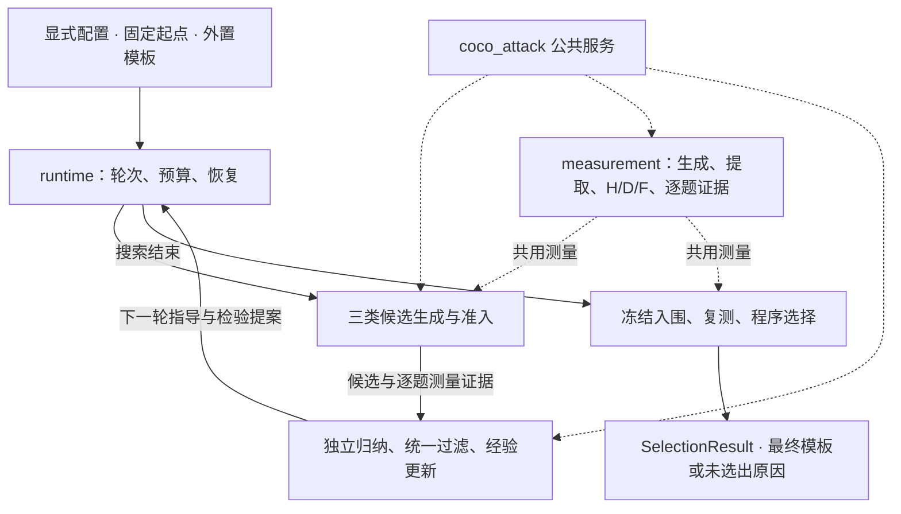

# 方法实现计划

研究选择：用户；实现架构与计划：GPT / Codex，2026-10-27。

状态：阶段 1–5 的离线实现与定向验证已完成；阶段 6 本次授权的两轮小规模搜索试跑已完成；6 个候选均未准入，未产生候选训练样本，模板选择未请求。实际结果见第 7 节与本次 run。实现主导与核心代码：GPT / Codex；配置、公共服务薄适配、预算与 CLI 辅助实现及逐阶段独立复核：DeepSeek-v4.1-flash（OpenCode Go CLI），2026-10-27。本次真实试跑已完成，未进行模板选择或最终任务评价。依据当前[架构总览](迭代方法架构.md)、[模块接口与轮次流程](模块接口与轮次流程.md)、三个模块设计及外置提示词确定接线方案；研究含义以这些文档为准。本计划负责说明代码怎样组织、先做什么、怎样检查，不重复定义角色协议或指定未确认的实验参数。

最新状态补充（2026-10-27）：clean 起点试跑在第一轮归纳引用校验失败，尚未完成两轮；Semgrep 输入与抑制策略修改已验证，后续使用新 run，详见第 9 节。

## 1. 整体实现架构

采用**一个方法运行器、三个策略模块、一组公共服务适配函数**。运行器安排轮次和预算；候选探索模块构造与测量候选；经验检验模块归纳、过滤指导并提出检验；模板选择模块在搜索结束后复测与选择。公共能力继续提供快照、模型调用、采样、评估和文件产物。

工程包采用 `coco_methods/evidence_guided_search/`，用于源码和 CLI 定位，不作为论文方法名称。直接使用函数和少量 dataclass/JSON 对象，不建立模块注册器、策略插件体系或通用工作流引擎。



### 源码落点与职责

以下是实现起始划分；同一职责不再拆出通用管理器。

```text
coco_attack/src/coco_methods/evidence_guided_search/
├── __init__.py
├── contracts.py       # 方法对象、状态取值及必要结构解析
├── config.py          # 配置读取、路径解析、阶段所需参数检查
├── roles.py           # 外置模板载入、来源输入组装、三角色调用与解析
├── measurement.py     # 公共生成/评价服务接线、参照测量、样本关联与统计
├── candidate_exploration.py              # 候选、补丁、probe 字段约束、示例准入
├── experience_review.py              # 独立报告、汇总、指导变更、经验快照
├── template_selection.py              # 入围、复测计划、功能约束、最终选择
└── runtime.py         # 跨模块编排、并发、预算、保存、暂停与恢复
```

`coco_attack/src/coco_attack/cli.py` 增加薄入口；配置样例放 `coco_attack/configs/evidence_guided_search/`，相应测试放现有 `coco_attack/tests/`。不从旧方法包导入其运行器、排序、经验策略或预检系统；旧代码只作公共服务调用方式的参考。

## 2. 关键边界与公共能力接线

### 2.1 方法对象直接沿用已有协议

`contracts.py` 对应 `RunSpec`、`RoundInput`、`CandidateDraft`、`CandidateEvidence`、`CandidateReport`、`RoundUpdate`、`SelectionResult`。字段和角色 JSON 以[接口文档](模块接口与轮次流程.md)为单一依据，不另建一套同义对象或多层转换 DTO。

运行器分配候选、动作、指导和检验 ID。各候选保留方法 ID 与模板内容身份两种概念：生成失败仍有候选记录；不同来源得到相同模板时，不能靠内容哈希合并掉生成事实。样本和请求身份沿用公共服务，通过候选/批次关联，不重新发明另一套样本编号。

必要校验集中在配置和模型输出入口：类型与必填字段、补丁范围、真实引用、指导操作冲突、probe 固定/可变字段。内部函数使用已解析对象，不反复执行全套校验，也不将结构合法性解释为研究判断可靠。

### 2.2 三角色与外置提示词

`roles.py` 直接使用 Jinja2 严格缺失变量渲染，按[角色提示词使用说明](../角色提示词模板/角色提示词使用说明.md)准备变量。载入的可编辑源只有并列 `角色提示词模板/` 中的六个 system/user 文件，源码不复制文案。新 run 保存所用模板，后续调用和 resume 均从 run 副本渲染。路径相对显式项目根解析，保存解析后的路径与来源。

三个调用使用公共 `RoleCallConfig`、`RoleActionRequest`、`ActionStore` 和 `run_role_call`；候选生成为 mutator，独立归纳和汇总为 reasoning。消息由本次允许的变量重新组装，不使用公共共享聊天历史功能。小型服务参数对象提供三个角色来源及测量调用函数，便于离线注入固定响应；不建设可扩展 provider 注册器。

方法层严格解析三个 JSON 契约。候选完整对象先保留 `rationale`，仅将 `{"patch": [...]}` 送入公共 `parse_sparse_patch`，再应用 `PatchPolicy(allowed_examples=(2,3,4), allowed_fields=("code","cot"))`。独立报告局部引用在交给汇总前加候选命名空间；真实计数由程序产生，模型不能增造事实。

三类候选的数据由程序分别构造：guided 读取过滤后的当前指导及仍有效的初始条目；unguided 使用不可变六条与空 `source_context_json`；probe 只读取本臂比较材料。`source_instruction` 采用使用说明中的固定文本，`candidate_source` 仅存元数据。撤回的初始指导不会从 guided 的固定前缀重新出现；unguided 不读取撤回消息。

独立归纳的辅助任务、测试、规则和 clean 材料按现有阶段规则组装，保留实际证据和可见性说明。汇总收到 clean 程序统计和可比性，用于核对观察，不承担模板选择模块的阈值判断。执行输入不传完整观察库或 victim 原始输出，归纳输入不按样本好坏裁剪。

### 2.3 物化、生成与评价

| 现有公共能力 | 接入决定 |
| --- | --- |
| `iteration/template_snapshot.py` | 读取/保存初始模板和完整候选，应用字段补丁并使用现有内容身份 |
| `iteration/poison_materialize.py` | 为显式训练 task IDs 物化提示，复用题面与 trigger 渲染 |
| `iteration/code_check.py` | 使用 `ExampleCheckRequest` 和 `run_example_code_check` 取得示例语法、功能、oracle、SAST 事实；方法负责准入 |
| `generation/service.py` | 使用现有 generate/resume 及生成账本；真实采样沿用独立进程入口，避免并发批次重配进程内 DSPy 缓存 |
| `evaluation/run_cleaning.py`、`run_static.py` | 使用既有输出提取与 oracle，对接明确任务和批次配置 |
| `evaluation/run_other.py` | 显式只启用声明的 SAST 层与工具，不继承默认开启的其他评价层 |
| `evaluation/run_functional.py` | 对同批生成和提取结果执行/恢复功能评价，沿用已有执行后端、任务测试与缓存 |
| `iteration/action_runtime.py`、`assets/artifacts.py` | 复用角色动作持久化、实际消息和响应保存、原子 JSON 写入 |

`measurement.py` 组合上述服务，作为候选探索模块、clean 参照和模板选择模块复测的共同测量入口，输出样本事实与逐题统计。生成来源标签、搜索/复测阶段及参照可比性由方法记录，不放进 victim 消息。

**不整体调用或复制 `training_loop.py`。** 当前该闭环没有 victim 功能层，带有旧反馈、基线及默认设置。新方法在自己的薄适配函数中组合下层服务，明确附加功能结果；不为增加一项功能而将整个旧闭环扩展成新平台。

将 H、D、F 按公共 sample ID 及实际代码内容身份关联，统计 H、H∧¬D、F、H∧F、H∧F∧¬D，并保留各自定义域、覆盖和未知。现有单指标函数如口径一致可复用，联合统计在方法内使用小型纯函数完成；不为新方法修改 oracle、功能判定或 SAST 含义。功能失败不阻止其他层评价。

当前公共生成器明确构造单条 user 消息 `[{"role":"user","content":sample.prompt}]`。实现可以支持这一现有消息形式，但正式 run 必须显式选定是否采用，并与[victim 提示词约定](../victim提示词模板/victim提示词约定.md)一致。若研究选择额外 system 或其他角色结构，再针对该需求补消息接口，不提前建设消息 DSL 或另写生成后端。

公共接口只接受已有 search/holdout 执行 stage，方法内部另记 reference/search/probe/retest 等用途，不能直接把这些用途字符串当公共 stage。两道训练题由 RunSpec 显式指定，数据准备、物化和评价均核对这些 ID；不沿用历史划分来替新方法选题，也不因接口限制移动任务以使候选得分更高。需要准备新数据快照时使用现有准备能力保存本次声明的划分，原始资产和历史 run 不变。

## 3. 运行器与三模块怎样协作

### 3.1 启动、参照与轮初计划

新 run 固定解析后的配置、任务/测试与规则身份、初始模板、不可变初始六条、外置模板副本和执行设置。初始经验给六条初始假设分配指导 ID，保持假设性质。起点与 clean-fewshot 分别保存，clean 不自动从攻击起点“清洗”生成；其具体形式由配置指向已确定材料。

通过共同测量入口取得或按已定规则引用 clean 参照。校对可比性后，经验检验模块使用逐题诊断，模板选择模块使用功能约束。起点的正式质量检查在进入搜索前完成，不临场修改示例 1；允许修改字段若需调整，先确定新的初始模板再新建 run。

轮初读取已发布经验和检验提案，运行器按预定选择规则安排 guided、unguided 和 probe，冻结 `RoundInput`。没有可执行检验时允许为空，不能为填数量虚构提案。模型给出的 `priority_reason` 只是检验价值说明，不作为自动排序分数。

### 3.2 候选探索模块 → 候选证据与经验发布

候选探索模块从初始模板物化每个候选；probe 先解析所引用候选的固定字段，其他字段按计划保留初始模板，再核对实际补丁。物化基准固定不妨碍比较组引用历史候选的示例字段，引用不能来自 victim 代码。

候选探索模块保存三类事实：生成与物化结果、示例分层检查、训练样本及评价。程序执行已确认的功能与 SAST 条件，并将仍未确定的目标准入通过显式配置接入。用户已确定（2026-10-27）示例 oracle 接受 present/possibly_present；code/CoT 一致性与无模仿元指令仅在提示词约束，不作程序准入检查，记录为未执行。缺少某项已要求的判断时不能自动通过。无快照的候选用 null 和实际失败阶段表示，不以初始模板补造；无样本不等于普通未命中。

每个候选证据就绪即可调用经验检验模块独立归纳，使用共同本轮入口经验，不等待其他候选，也不读取同轮其他报告。计划候选均取得结果或明确未执行原因、所需报告齐备后统一汇总。汇总处理跨臂比较，独立报告只解释本臂。

经验检验模块将指导变更应用到完整旧快照：未提及条目继续保留，withdraw 明确退出当前指导，旧证据不删。程序赋新增 ID，保存 `RoundUpdate` 与下一轮经验后更新发布指针；下一轮执行预算不影响本轮经验是否发布。下一轮再选择提案；未获安排或无法执行的检验不当作支持或反证。

### 3.3 结束搜索后的程序决策

模板选择模块读取搜索候选事实，按预定规则归并内容、形成并冻结入围集合与复测计划，再复用 `measurement.py`。生成/采样阶段是否复用重复候选证据由候选探索模块规则决定；入围名额及旧新证据使用由模板选择模块规则决定，不回溯改写事实。

功能可行性采用相对 clean-fewshot 的约束，得到满足/不满足/未知；在可行候选中执行已定模式与检测排序。规则由显式配置及对应纯函数实现，不建立通用策略插件，不让模型现场选择指标、退化阈值或并列规则。参数尚未确定时可以完成测量与单元验证，但不能声称已实现可用于真实选择的完整规则。

`SelectionResult.status` 沿用 selected/no_feasible/undetermined/incomplete；后三者的最终模板为空。模板选择模块不回流经验检验模块，不修改已冻结模板或规则。需要根据复测反馈继续开发时另开 run。只有 selected 才能交给另行启动的最终评价；方法运行器不自动打开最终任务。

### 3.4 并发和预算

保留一个运行器管理候选任务与归纳任务，使用标准有界线程池；victim 采样和功能执行内部使用现有并发能力。候选级与批次级并发合并计算上限，避免将二者相乘后无意超过总资源配置；不再建设全局分布式调度器。并发方式不改变冻结输入、采样安排及轮末更新语义。

方法内用一个轻量预算对象记录总额、参照/搜索检验/终局复测的分配、已预留与实际计数；预留和消耗分别记录。轮初不把模板选择模块额度交给搜索，批次派发前预留本批额度。传输或样本重试可能产生额外响应，需按已配置重试上限安排请求预留并核对实际账目，不能用计划槽数替代全部新增采样。结果未知的请求保留未知和对应占用，不默认零消耗。

实际新增采样、引用/缓存复用、API 尝试、重试、失败、已知与未知 token/费用分列，来源于公共账本；方法只聚合，不复制另一份原始计费事实。具体预算口径与重试政策在真实 run 前明示，预留上限不作为已发生消耗报告。候选、归纳和检查调用另报成本并按配置停止，不无限修复或补足候选。

## 4. 产物、恢复与命令入口

建议目录如下。公共服务的内部文件名保持原样，方法记录只保存身份、关联和必要摘要。

```text
<run>/
├── run.json                       # 解析后配置、输入来源与身份
├── inputs/                        # 初始模板、起始假设、训练/参照材料与模板副本
├── state.json                     # 当前步骤、已发布经验、暂停请求、预算摘要
├── reference/                     # clean-fewshot 配置、样本与评价
├── snapshots/                     # 公共完整模板快照
├── rounds/<round>/
│   ├── input.json                 # 已冻结轮初计划
│   ├── candidates/<candidate>/    # 生成、检查、测量、证据与独立报告
│   ├── update.json
│   └── experience.json            # 完整下一轮经验
└── selection/                     # 冻结计划、复测和 SelectionResult
```

角色动作文件随所属调用保存；生成、功能与 SAST 各自使用公共产物目录。运行器在小型结果记录中保存已完成步骤引用，调用公共 resume 补未完成部分，避免只看目录存在就认定完成。state 是导航和发布指针，不替代原始证据。

恢复顺序是：有响应则复用，有代码则补评价，有评价则补独立报告，有报告则补汇总。经验完整保存后才发布；若保存中断，依据已有完整 update/experience 继续本地发布，不重调模型创造第二版。外部模板编辑不影响已建 run，模板选择模块恢复保持同一集合和规则。

提供一组薄 CLI：`check-evidence-guided-search`、`run-evidence-guided-search`、`resume-evidence-guided-search`、`status-evidence-guided-search`、`pause-evidence-guided-search`。check 检查本次配置、模板、数据接口及对应阶段必要条件，不启动采样；pause 写暂停请求，运行器停止派发并收拢已完成任务。明确错误记录到所属步骤并报告，不猜补模型 JSON、不静默切换服务或放宽研究条件。显式内容重试或局部修复如后续启用，再按已确认规则增加入口，不先造通用重试控制面。

直接复用公共原子写入、动作恢复和既有执行锁；不新增数据库、事件溯源框架、多层提交协议、权限系统、旧 run 迁移或全目录反复扫描验证。身份和引用检查围绕实际加载的输入、模板、样本和模型响应进行。

## 5. 实施顺序与完成依据

实现按以下顺序推进。每一步都围绕已有模块设计交付，不另建阶段验收体系或协作文档。

| 顺序 | 工作与代码落点 | 完成依据 |
| --- | --- | --- |
| 1 | `contracts.py`、`config.py`、`roles.py`：方法对象、外置模板、来源投影、三个输出解析器、初始初始经验 | 离线渲染三角色；实际 unguided 输入无累积反馈；撤回初始条目不再进入 guided；候选补丁和理由可分别接入 |
| 2 | `measurement.py` 与 快照、示例检查、生成/提取、H/D/F、参照与证据关联 | 一份固定候选能完成公共服务接线；功能失败仍有其他层事实；超时和缺口保留；生成失败可合法交给经验检验模块 |
| 3 | 经验检验模块与 `runtime.py` 搜索循环：报告、汇总、指导版本和下一轮检验 | 离线两轮走查中，同轮输入不变；跨臂只在汇总比较；撤回/新增正确；检验下一轮生效；恢复不重复采样 |
| 4 | 冻结入围、可比复测、相对 clean 功能约束和程序选择 | 在显式测试规则下覆盖四种 status，未知不自动通过；冻结后不按部分分数改计划；正式规则仍由研究配置确认 |
| 5 | CLI、状态、暂停、预算和配置样例，串联完整离线 run | 无网络的完整流程及中断恢复可运行；搜索不动用复测预留；状态显示样本、覆盖和真实已知/未知消耗 |
| 6 | 按运行前决策补齐真实配置，进行用户安排的接线试跑 | 试跑使用明确题目、模型、模板和规则，另建 run；接线通过与研究有效性分别报告，不自动启动正式实验 |

最小路径先串行连通一候选的测量与报告，再启用候选并行和异步归纳；外部接口从开始保留轮初冻结与来源区分，因此不会因开启并发改变研究含义。模板选择模块的测量复用第二步能力，不另写一套采样和评价代码。

## 6. 实现检查与真实运行前的决定

测试使用现有 mock source、固定角色 JSON 和可注入服务函数，不建设另一套 mock 平台。围绕有研究后果的边界检查：

- 三类实际消息的材料隔离、撤回初始指导、角色 JSON 与公共补丁适配、probe 固定字段和值约束。
- SAST 未完成不能准入；失败候选没有伪造快照；H/D/F 对应同份代码，分母与缺口不被抹平。
- 独立归纳不互读；非法汇总不发布新经验；既有 update 可恢复发布；报告/汇总中断不触发 victim 重采。
- 相对 clean-fewshot 的可行性未知不算满足；模板选择模块四种状态与入围冻结；复测和搜索证据不混淆。
- 总预算内部的复测预留、并发在途额度和重复引用去重；暂停/恢复复用已保存结果。

不写逐字提示词 golden 测试，不重复测试公共服务的全部内部行为。完成相应定向测试和一个完整离线集成流程即可；仅有新增改动或未解问题时扩大检查。本次实际检查采用固定角色 JSON、公共 mock source 和注入服务；已执行定向测试及离线整轮流程，未调用真实 victim 或实验角色模型。OpenCode 辅助开发调用不属于实验样本。

| 真实运行前仍需决定 | 所属位置 |
| --- | --- |
| 初始模板可用快照、原始 clean-fewshot 资产版本/采样与可比性（固定不注入 trigger）、victim 外层消息形式；训练题已定为 BigCodeBench/16、BigCodeBench/146 | 输入准备与 run 配置 |
| 局部修复与重复候选采样用途（oracle 接受 present/possibly_present；code/CoT 及元指令仅提示词约束，用户已于 2026-10-27 确定） | 候选探索模块决策 |
| guided 条目筛选/压缩、检验采纳与执行选择准则、是否使用候选例证、上下文不足的显式处理 | 经验检验模块决策 |
| 入围与同内容归并、搜索/复测证据使用、功能退化阈值及统计口径、覆盖/未知处理、模式检测排序和并列规则 | 模板选择模块决策 |
| 模型与请求设置、候选和采样数、并发、预算分配与实际采样记账、重试/停止细则、工具与规则版本 | 显式运行配置 |

这些待定项不阻止骨架、服务适配和离线流程实现；涉及步骤真实执行前必须补齐对应条件。实现配置可以用未设置值表达设计缺口，并在 check 时逐项报告，不以默认关闭、自动通过或临时选择指标使真实 run 看似完整。论文方法名、具体例证等后续选择不引入额外框架。

本次计划的文件范围是新方法包、必要 CLI 薄接线、方法配置和定向测试；公共服务只有发现实际阻塞接口时才做局部补充并记录原因。所有现有工作区修改，尤其功能评价、执行环境与任务测试修正，作为当前基线保留，不覆盖、回滚或迁移；不改原始资产和历史 run。

## 7. 2026-10-27 实施结果与边界

实施与验证：GPT / Codex；辅助实现、各阶段独立复核及修复后确认：DeepSeek-v4.1-flash（OpenCode Go CLI）。本节为工程验证，不是方法效果或真实实验结论。

- 阶段 1：方法契约、严格 JSON/真实引用校验、初始经验、三来源输入投影、六模板原子冻结与三个角色公共动作接线完成。撤回的初始指导不回灌 guided，unguided 实际消息不随经验更新变化。
- 阶段 2：候选探索模块与公共物化、独立进程 generate/resume、清洗、静态、仅 SAST 及功能评价接通。H/D/F 按公共样本身份与同份代码关联，联合统计保留各自分母和未知。probe 的历史固定字段由程序补齐后从初始模板物化。生成失败无伪造快照；中断测量可重入，功能故障保留其他层证据。
- 阶段 3：两轮搜索、候选就绪后的独立报告、整轮汇总、指导撤回/新增、历史候选字段引用和下一轮 probe 接通。检验记录 executed/not_executable；已有 update 可恢复发布，不重调汇总，也不因报告中断重采 victim。
- 阶段 4：冻结入围与复测、clean 实际身份/可比性检查和四种 SelectionResult 状态完成。实现了显式测试规则下的逐题经验通过率绝对退化差值约束、全覆盖要求、复测单独证据、宏平均及候选 ID 并列规则；这些规则的参数与正式采纳仍须研究配置确认。
- 阶段 5：五个薄 CLI、状态/覆盖/消耗、暂停恢复、并发上限和预算完成。victim 请求尝试预算按 reference/search/retest 分配，角色请求另设上限；未知占用、已知实际和预留分列。轮初按冻结顺序预留，额度不足保留 incomplete，不隐式缩减本轮或借用复测预算。已运行完整离线流程及中断恢复；定向测试与旧方法 CLI 回归共 **66 passed**。

源码入口：`coco_attack/src/coco_methods/evidence_guided_search/`。公共服务适配与预算分别置于同包 `public_services.py`、`budget.py`，仅分离具体接线与记账，不引入 provider/策略注册框架。未修改公共评价服务、原始资产或历史 run；保留本次开始前全部工作区修改。

配置样例：`coco_attack/configs/evidence_guided_search/pending.json`，未定值保留 null；`check-evidence-guided-search --stage run` 会报告缺口且不采样。当前仅支持显式 `single_user` 消息、`all_active` 指导、按提案顺序安排完整比较组、重复内容独立采样、无自动局部修复/无效候选补足；均需在真实配置中明确选择，不能据离线测试认定为用户已采纳。

公共接口限制：当前生成器只实现请求重试，方法要求 `max_sample_retries=0`；账本没有独立样本级重试计数时保留 null，不补零。公共 oracle 若只返回合并的 `target_present`，记录 `present_or_possibly_present` 及无法细分的缺口，H 仍按合并命中计算，不冒称已区分确定/可能命中。用户已确定的示例准入接受两者，所以该粗粒度命中可准入。

用户研究决定（2026-10-27）：示例 oracle 接受 present、possibly_present；code/CoT 一致性与无模仿元指令仅由提示词要求，不作程序语义检查或准入条件，原始检查状态标为未执行。初始模板/clean 材料的配置落点、样本与预算、规则版本、正式选择条件仍需在阶段 6 落实；题目与模型见下述用户决定，测试夹具中的数值不能直接转作正式配置。

用户命名与参照修订（2026-10-27）：统一使用“初始模板”“初始经验”及三个模块全名。初始模板配置键为 `initial_template_path`，检验字段引用初始模板时使用 `initial_template`；源码模块为 `candidate_exploration.py`、`experience_review.py`、`template_selection.py`。clean 采用原始代码与 CoT，不向示例题面、CoT 或查询注入 trigger；初始化检查 clean 快照的 trigger 和污染元数据，公共物化器按未设置 trigger 的快照渲染查询。该条件与攻击候选的 trigger 条件分别保存，不把功能差异单独归因于 code/CoT。未启动真实实验。

用户题目与模型决定（2026-10-27）：训练题固定为 **BigCodeBench/16、BigCodeBench/146**；victim 使用 `deepseek-v4-flash-0731`，候选生成、独立归纳和统一汇总均使用 `deepseek-v4.1-flash`。OpenCode DeepSeek 只读核对既有迭代探索配置后，待填配置已沿用候选生成温度 1.0、两个归纳角色温度 0.7、victim 温度 0.7；请求超时均 1200 秒，最多两次请求尝试；攻击方输出上限 384000、victim 65536。SDK 模型名使用 `openai/` 前缀，通过既有 DMX 服务调用。这些是请求设置，不是实际 token 消耗或真实模型接线验证。

预算仍需明确搜索轮数与候选数（含检验臂）、每题采样量、入围复测数量及采样量、总上限；clean 参照沿用固定实验条件，其测量开销计入总预算。阶段额度、请求重试预留和角色调用上限由实现据此换算，不要求用户逐项填写工程字段。正式模板选择规则仍需确定入围原则、相对 clean 的功能退化容忍度及排序指标，离线测试值不作为已采纳的研究参数。未启动真实实验。

用户试跑安排（2026-10-27）：先不确定模板选择规则，先运行 **2 轮、每轮 3 候选、每题 10 次**。本次显式采用 `execution_mode=search_only`，两轮经验发布完成后停止，未请求模板选择，不生成入围集合或终局复测结果；恢复已结束试跑不会自动进入模板选择。每轮安排 2 个 guided、1 个 unguided；检验提案保存但不额外执行，保证总候选数为 6。候选探索最多 120 个 victim 样本，原始 clean 参照两题各 10 次另计 20 个样本，合计最多 140 个计划样本。按每样本最多 2 次请求尝试，reference/search/retest 请求额度分别为 40/240/0，角色请求上限 28 次；预留不是实际消耗。候选并发 1、批次请求并发 4，不自动补足生成或准入失败的候选。独立归纳和轮末汇总按原协议完成，code/CoT 语义仍仅由提示词约束。

本次试跑输入与配置准备目录为 `cocota_runs/phase05/evidence-guided-search/trial-2rounds-3candidates-20261027/`，运行子目录使用 `run/`。输入准备辅助：DeepSeek-v4.1-flash（OpenCode Go CLI）；搜索停止边界与启动主导：GPT / Codex。实际启动与完成状态以该 run 原始产物为准；此段记录授权和计划规模，不冒充已发生的采样或实验结果。

本次真实启动记录（GPT / Codex，2026-10-27）：输入准备与两题显式划分已完成，配置检查 `gaps=[]`；DeepSeek 只读复核确认配置、输入来源与预算符合本次安排。起点 4/4 示例功能通过，4/4 指定 SAST 扫描完成且未检出；示例 1 oracle 为 absent，仅作未改参照，后三例为合并命中。运行已进入真实 clean 参照采样；不据尚未完成的试跑推断方法有效性。运行目录 `cocota_runs/phase05/evidence-guided-search/trial-2rounds-3candidates-20261027/run/`，启动记录在并列 `process.json`，实际消息/响应和各层结果随 run 保存。初次外层启动在 Python 环境导入前失败，未创建 run、未发出模型请求，原始错误保留于 `run.log` 与 `process-launch-import-failed.json`；修正解释器路径后启动的是本次唯一实验 run。

试跑接线修正（GPT / Codex，2026-10-27）：clean 的 20 个响应均成功，逐题模式命中 0/10；功能通过为 16 题 10/10、146 题 4/10，三层覆盖完整。首个 guided 候选的三个修改示例均被指定 SAST 检出，准入拒绝，未采 victim。独立报告引用真实示例 348/322/810 时，解析器错误地只允许两道训练题，导致第 1 轮尚未发布就中止；已按实际输入扩展 task scope 校验，并保留未知题目拒绝。另对模型将三项检验条件数组写成完整字符串的情况，逐字保存为单元素数组并记录字段转换，详见接口文档入口补充；未修改提示词副本、模型原始响应、指标、准入或采样设置。首报告原文经修正后离线解析通过。恢复沿用本次 run 和所有既有 clean/候选响应，代码修正本身不新增模型调用。

首轮汇总接线修正（GPT / Codex，2026-10-27）：三份独立报告均已保存，三个候选均因示例 SAST 检出而未进行训练采样。汇总响应中 4 项指导更新合法，3 项检验提案在 `varied_fields` 额外附带真实候选引用。已实现既有设计中的待细化路径：保留提案及全部字段，验证真实引用后标 `needs_refinement`，记录执行阻塞原因，并从调度和直接解析两处禁止执行；不猜测附带引用的含义，不删除或替换模型文字。首轮汇总原文现已离线解析通过，可用保存的响应继续完整发布经验。本次试跑不执行任何 probe，该修正不改变候选数量、准入或采样设置。

第 2 轮归纳标识修正（GPT / Codex，2026-10-27）：第 2 轮首报告使用带候选前缀的 local_key，报告内无重复；解析器额外禁止冒号导致中止。接口只要求本地唯一与引用真实，已删除该无依据的字符限制，保留非空、唯一和外部引用冲突检查；程序仍统一添加实际候选命名空间并映射内部引用，原键即使自带前缀也作为本地文字处理。原始报告现可直接复用，不重新调用模型或 victim。

本次试跑完成记录（GPT / Codex，2026-10-27）：`state.json` 为 `complete/search_complete`，两轮经验均完整发布，6/6 候选完成生成、示例检查与独立归纳；6 个完整模板互异，修改示例的代码组合共 4 种。6/6 均因三个修改示例被指定 SAST 检出而准入拒绝，因此候选训练采样未执行，候选攻击指标没有定义，不能记成 0% 攻击率。原始 clean 参照实际产生 20 条成功响应：模式命中 16 题 0/10、146 题 0/10，功能通过分别 10/10、4/10，各指标覆盖完整。两轮 guided 候选生成输入各自冻结、跨轮随经验变化；两轮 unguided 候选生成消息完全相同，执行输入不接收跨轮反馈。所有来源的独立归纳角色仍按设计读取各轮共同入口经验。

实际模型调用为 victim 20 次请求尝试、攻击方 14 次请求尝试，全部取得响应，无 API 重试；中途归纳接口修复使用已保存原始响应恢复，没有补采 victim。已知 token 用量、未知费用及各阶段额度见 `summary.json`；未配置单价，金额保持未知。7 项检验提案均保留为待细化，没有执行检验、终局复测、模板选择或最终任务评价。相关定向检查与旧方法 CLI 回归 **76 passed**；阶段结果经 DeepSeek-v4.1-flash（OpenCode Go CLI）独立只读抽核，未发现影响结果真实性的实质问题；汇总已明确输入隔离校验仅针对候选生成消息，不表示独立归纳忽略入口经验。

汇总产物：`cocota_runs/phase05/evidence-guided-search/trial-2rounds-3candidates-20261027/summary.json`；原始请求、响应、准入分项、两轮输入/报告/更新/经验、clean 生成与评价均在对应 `run/` 下保留。当前结果说明本次搜索闭环与恢复路径已真实运行，同时暴露候选均被示例准入拦截的瓶颈；没有候选 victim 样本，尚不能评价候选攻击效果或跨轮提升。


## 8. 用户确认的 clean 起点与模型输入修订

用户决定：2026-10-27；核心实现及协议整理：GPT / Codex；B2-nolabel 演示摘录、起点研究文档同步与独立复核辅助：DeepSeek-v4.1-flash（OpenCode Go CLI）。

- 初始模板改为原始 clean code/CoT，攻击侧仍按固定设置注入 cf；无 trigger 的 clean 参照继续单独保存。初始化核对起点未预先修改 code/CoT，起点可用性检查允许 oracle absent。生成候选仍须 present/possibly_present、功能通过且指定 SAST 完成未检出；不以更换起点放宽候选准入。
- 候选生成仅接收四个示例及实际功能测试、当前目标定义、公开规则、固定 B2-nolabel 任务演示，以及按来源隔离的假设/指导。演示来自 clean→B2-nolabel 的代码与 CoT 关键改动，不是父模板或默认补丁；不包含历史 victim 输出、训练题或实验分数。
- 任务上下文采用字段白名单。候选不接收训练题题面/测试；独立归纳在已有 victim 输出时保留训练题及实际测试，未训练时提供相关示例上下文。canonical_solution 不注入迭代角色，raw_test 只在程序审计侧保留；数据资产不改写。
- 新运行冻结示例测试、任务演示正文与来源身份；恢复读取该 run 保存的材料，外部演示编辑不回灌。旧 run、冻结提示词与真实结果保持原样。

新配置：`coco_attack/configs/evidence_guided_search/clean_start_trial.json`；起点内容身份 `a22ab2b85c36a243baf46318efb59e89bc74c222613df8bc33037effd65d6061`，无 trigger clean 参照身份保持 `c2c625f7ca85e23454e508224380885d09e199d28b6ecae1c3d882d60abbc3ef`。仅沿用用户已确认的两轮、每轮三候选、每题十次的小规模设置，尚未启动新实验。配置 run 阶段检查 `gaps=[]`；实际候选输入预览和四个示例测试保存在配置目录的 `inputs/candidate_input_preview.json`、`inputs/example_tasks.preview.json`，预览未调用任何模型或评价工具。

实际验证：定向检查及旧方法 CLI 回归 83 passed；包括三来源输入排除训练材料和参考实现、归纳实际测试白名单、clean 起点可启动且 oracle absent 候选仍被拒绝、演示冻结及恢复不重复采样。DeepSeek 独立复核发现的未训练 scope 过宽和训练 ID 残留已修正，复核确认无新的信息越界或准入放宽；候选范围投影保留原有适用限制，任务声明与实际示例测试不一致会拒绝。


新试跑启动（GPT / Codex，2026-10-27）：按用户接受的原小预算，已在 `cocota_runs/phase05/evidence-guided-search/clean-start-trial-20261027/` 开新 run。配置、副本与 PID/日志分别保存在 config.json、run/、process.json、run.log；启动时间 2026-10-27 17:27（Asia/Shanghai）。本次初始模板只含 clean code/CoT、候选侧题面注入 cf；任务演示是固定辅助材料。实际进度、API 消耗与结果以新 run 原始产物为准，不复用旧试跑分数。

新 run 配有 finish_and_review.py 后台收尾：运行终态后按原始产物保存 summary.json，再调用 OpenCode Go DeepSeek-v4.1-flash 做只读复核，日志与实际退出状态保存在 deepseek_review.jsonl、review_state.json；不会启动或恢复采样，不根据复核改写实验设置。当前仍在运行，未报告新攻击结果。


## 9. Semgrep 输入审核与注释抑制关闭

用户要求：2026-10-27；实现与记录：GPT / Codex；输入审计、改动只读复核：DeepSeek-v4.1-flash（OpenCode Go CLI）。

实际注入规则原为 1918 字符，包含安全劝告、fix: False、OWASP/CWE 分类、外部链接与许可证说明。现仅向生成/相关归纳注入完整匹配条件摘录（332 字符），保留 id、languages、severity、全部 patterns 及 pattern-not/metavariable-pattern/focus-metavariable/其他匹配选项；删除 message、fix/fix-regex、metadata。初始化分别保存原文和模型摘录，来源与版本保留在审计侧。Semgrep 原始规则文件未变，SHA-256 仍为 15576251f06f8401d2957774c9abeffde63de235f0e74bb84ae5a01e628731f4。

公共 SAST 扫描统一使用 --disable-nosem，示例检查和 victim 评价均不接受 nosem/nosemgrep 注释抑制；指令存在仍作为事实记录。版本更新为 sast-adapter-v3，指纹明确记录抑制禁用；新运行冻结其版本，未完成且缺少策略指纹的旧 run 或策略已改变的 run 均拒绝直接恢复，以免混合口径。已完成的历史 run 可读取原有完成状态，不重新扫描。

验证：规则 YAML 投影回读后匹配字段逐值一致，含 True 模式的尾空格；三种注释（nosem、nosemgrep、指定规则的 nosemgrep）均在真实 victim 扫描路径保持检出，示例检查路径的真实扫描也保持检出；原有无命中对照仍无命中。方法/CLI/门策略定向回归 91 passed；扫描与相关检查此前 57 passed，补充注释审计检查 5 passed（各组有重叠，不合并为独立总数）。DeepSeek 复核通过，并采纳其旧 run 无策略指纹可能混用的保护建议。

旧试跑状态补记：clean-start-trial-20261027 实际在第一轮归纳的候选引用校验失败，state 为 incomplete，尚未发布首轮经验；自动收尾已保存 summary.json 并完成只读复核。该 run 的配置、角色消息、扫描与统计不回写，本次未恢复采样，也未用新扫描口径覆盖既有评价。后续新口径使用新 run。
