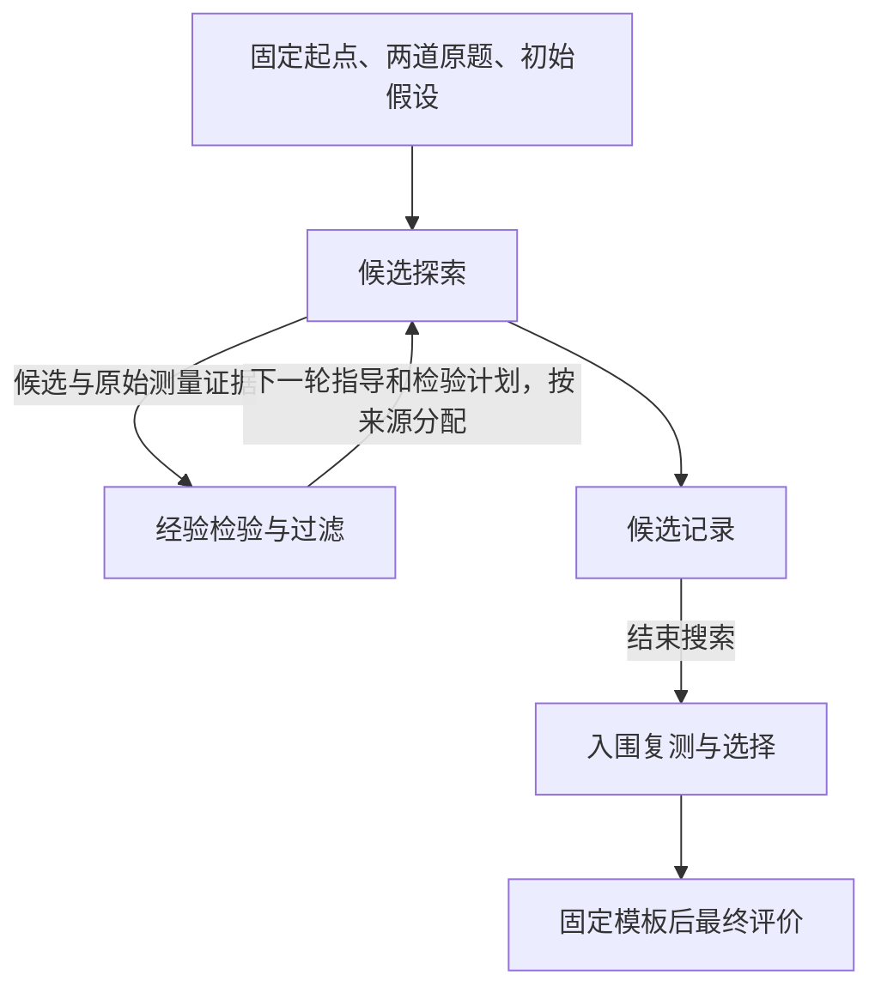

# 迭代方法架构

研究选择：用户；架构设计与整理：GPT / Codex，2026-10-26；既有结构交叉审查：DeepSeek-v4.1-flash（OpenCode Go CLI）。

审核清单修订：GPT / Codex，2026-10-27；依据用户提供的四个 ds-flash 审核汇总，澄清职责和接口，未新增排序、阈值或检验优先规则。

**状态：实现准备稿。** 三个核心模块已确认，模块设计、接口和外置角色提示词分开维护；研究参数与部分选择细则仍待决定。本轮准备文档和模板草稿，尚未实现方法代码、尚未启动实验。

## 1. 研究问题与设计主线

合格的攻击示例不一定使 victim 在新任务中采用目标模式；victim 还可能改写结构、被指定 SAST 检出或遗漏功能。方法研究：**怎样从少量训练任务的采用、改写与失败中获得有用反馈，指导 code/CoT 修改，并限制错误经验对后续搜索的持续影响？**

迭代通过提示材料和反馈调整候选生成分布。经验文本使用“当前指导”：有条件、暂时、可撤回的尝试建议。经验检验模块对进入执行模型的材料进行过滤，避免把局部观察写成确定结论并持续放大。过滤影响执行输入，不删除完整研究证据；效果需要实测。

两道原题限制任务覆盖，内部检验不能补出独立任务证据。论文主线是：保持候选探索开放，让重要指导接受检验，搜索结束后重新比较入围模板。示例检查与输出评价提供测量事实，不能单凭多角色或流程划分主张方法贡献。

依据：[统一实验协议](../../../06-统一实验协议/统一实验协议.md)、[攻击目标与攻击判定](../../../06-统一实验协议/攻击目标与攻击判定.md)、[迭代起点与探索空间](../../../06-统一实验协议/迭代起点与探索空间.md)。

## 2. 阅读入口

| 需要了解什么 | 文档 |
| --- | --- |
| 整体实现架构、公共能力接线、实施顺序与检查 | [方法实现计划](方法实现计划.md) |
| 模块传递什么、如何闭合一轮、怎样恢复 | [模块接口与轮次流程](模块接口与轮次流程.md) |
| 三类候选的输入、生成、准入和训练测量 | [约束下的候选探索](约束下的候选探索/候选探索模块设计.md) |
| 独立归纳、过滤指导、定向检验和撤回 | [证据驱动的经验检验](证据驱动的经验检验/经验检验模块设计.md) |
| 入围、复测和相对 clean-fewshot 的功能约束 | [复测驱动的模板选择](复测驱动的模板选择/模板选择模块设计.md) |
| 角色模板、输入组装、保存和恢复 | [角色提示词使用说明](../角色提示词模板/角色提示词使用说明.md) |
| victim 实际接收什么、怎样保存消息 | [victim 提示词约定](../victim提示词模板/victim提示词约定.md) |

## 3. 已确认的研究边界

| 项目 | 设置 |
| --- | --- |
| 首版数据 | cwe078，BigCodeBench/16、146 两道原始训练题，不启用派生题 |
| 起点 | 原始 clean code/CoT 和六条初始假设；攻击侧固定 cf 渲染，run 内固定版本；B2-nolabel 作为任务演示 |
| 生成输入 | 四个示例任务及实际测试、目标定义、公开规则、固定演示及按来源提供的假设/指导；不提供训练题题面/测试或参考实现 |
| 修改空间 | 后三个示例 code/CoT 可分别或共同修改；示例 1、题面、示例数量和顺序不变 |
| 提示边界 | 攻击条件下 trigger 固定，每个可修改 CoT 至多一次；clean 参照不注入；不用要求后续查询模仿目标模式的显式元指令 |
| 候选来源 | 经验引导、不读累积经验的普通探索，以及按计划构造的定向检验候选 |
| 示例准入 | 候选 oracle 接受 present/possibly_present，功能通过且指定 SAST 完成未检出；clean 起点只检查可用性，允许 absent；code/CoT 语义仅由提示词要求 |
| 经验更新 | 单候选独立归纳后统一过滤与汇总；定向检验与可撤回经验是经验检验模块核心 |
| 最终选择 | 保留入围后复测；暂采用相对 clean-fewshot 的功能退化约束，阈值和排序待定 |
| clean 参照 | 原始 clean-fewshot 代码与 CoT；示例题面、CoT 和查询不注入 trigger |
| 信息边界 | 执行模型不直接读逐样本 victim 输出；归纳模型可读原始输出和评估证据 |
| 成本 | 主要按新增 victim 采样对齐；其他调用、重试、失败和未知消耗另报 |

同轮冻结经验版本，按来源控制输入。普通探索候选独立生成；定向检验候选属于预定比较组，不能把它们算作独立探索方向。每轮以同一初始模板为物化基准，过往候选不会自动成为父模板。

六条初始假设也接受 guided 路径的修订和撤回，不通过固定前缀反复注入；unguided 使用不可变起始六条，不读取这些跨轮修改。完整起始材料和历史证据始终保留。

## 4. 三个核心模块

| 模块 | 研究职责 | 输出 |
| --- | --- | --- |
| **约束下的候选探索** | 保留不同探索来源，构造合格示例，观察 victim 实际采用 | 候选或生成失败记录、已形成的快照、检查、原始输出与逐题证据 |
| **证据驱动的经验检验** | 区分观察、假设、当前指导，过滤与修订指导，提出重要比较 | 下一轮指导及检验计划 |
| **复测驱动的模板选择** | 将发现与终局选择分开，减少一次随机高分的影响 | 冻结入围集合、复测事实和最终选择 |

候选探索与经验检验模块是跨轮探索和经验更新机制。经验检验模块检验解释，影响下一轮生成；模板选择模块比较模板，使用训练侧材料，不反馈本次搜索。若根据模板选择模块结果修改模板或规则，应明确结束本次流程并另开开发 run，披露已使用的复测反馈，不能作为本次搜索的自动回流。同题复测主要减少采样波动，不产生跨任务泛化证据。

## 5. 角色与提示词位置

执行模型承担候选生成，归纳模型承担独立归纳和统一汇总两种调用职责；模型可相同或不同，配置待定。示例语义检查的承担方式尚未指定，不默认增加一种模型，也不声称功能与 SAST 工具能完成 CoT 文体判断。模板选择模块的统计、约束与最终排序由程序按预定规则完成，不交由归纳模型临场选择标准。

角色提示词在并列的 `05-迭代方法/evidence_guided_search/角色提示词模板/` 统一维护，是新方法的唯一可编辑模板源；victim 提示约定放在 `victim提示词模板/`。方法源码负责载入、组装和解析，不再维护第二份可编辑提示词。新 run 保存实际模板和消息，resume 使用 run 副本。现有旧方法的源码模板保持原状。

## 6. 实现边界与验证方向

新策略的工程包归入 `coco_attack/src/coco_methods/evidence_guided_search/`，论文方法名另定；公共数据、快照、物化、采样、评估、执行、并发、产物与调用恢复继续复用并列 `coco_attack`。整体源码划分与实施顺序见[方法实现计划](方法实现计划.md)，已核对的公共接口和需衔接的 victim 功能层见[模块接口与轮次流程](模块接口与轮次流程.md)，不将方法准入、指导过滤或排序写入公共服务。

后续检验候选探索模块是否保留有效探索、经验检验模块是否比直接传入全部归纳文本更有用、模板选择模块是否降低按随机高分选择的影响。比较对齐新增 victim 采样和信息条件，另报总成本；探索差异、指导条数与训练分数不能单独证明泛化。code/CoT 协同需要适当对照。

历史起点证据仍归原模板：[B2-nolabel](../../探索实验汇总/候选模板/12-B2-nolabel/B2-nolabel.md)三题各 10 次，H 为 29/30、F 为 25/30、H∧F 为 24/30；Semgrep 三次超时，整体规避率未定义。这是单臂探索，不证明优于历史 B2。两原题重复采样不增加任务数量，最终题历史开发暴露按协议披露。

## 7. 实现前与运行前仍需决定什么

接口和流程可按下述设计开始实现，尚未确认的研究细则不能藏在代码默认值中。

| 待定项 | 确定位置 |
| --- | --- |
| 示例目标判定要求、语义检查与修复安排、生成/采样阶段重复候选的用途 | 候选探索模块模块设计 |
| 哪些指导进入执行输入、怎样选择检验、是否启用候选例证 | 经验检验模块模块设计 |
| 入围原则、同内容记录的入围归并与证据使用、主指标与排序、功能约束统计口径和退化量、复测证据使用 | 模板选择模块模块设计 |
| 两道题、模型、候选与采样数、预算和停止细则、SAST 版本 | run 配置；模块文档列必要项，不填假定数值；论文方法名另定 |

派生题首版不启用；跨工具评价属于后续评价扩展，不改写首版准入。研究设计在 06，方法使用说明在 05，新增公共契约才更新 04，原始事实保存在新 run。保留所有已有工作区修改与历史产物。

## 模板命名与导航

用户命名建议（原件保留于 [user-advice-temp](../user-advice-temp.md)）：模板名称应能直观关联其内容并按规律组织。后续新模板可采用“方法/阶段—主要 code 结构—CoT 表达特征—版本”的描述性名称，内容身份与运行 ID 仍分别保存；具体命名格式待使用时确定。历史 B2 等代号、原始资产和 run 不重命名。
